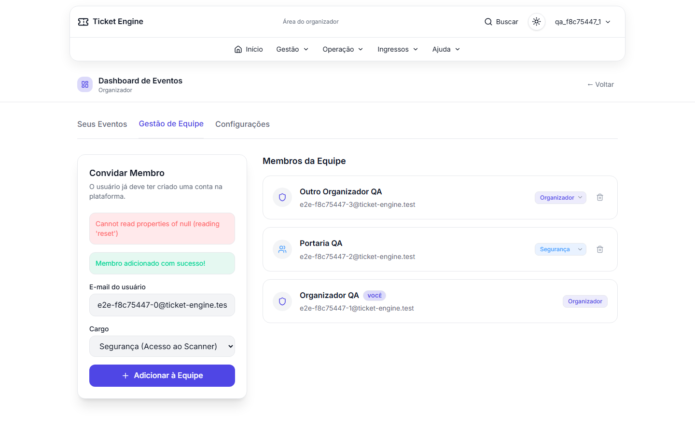
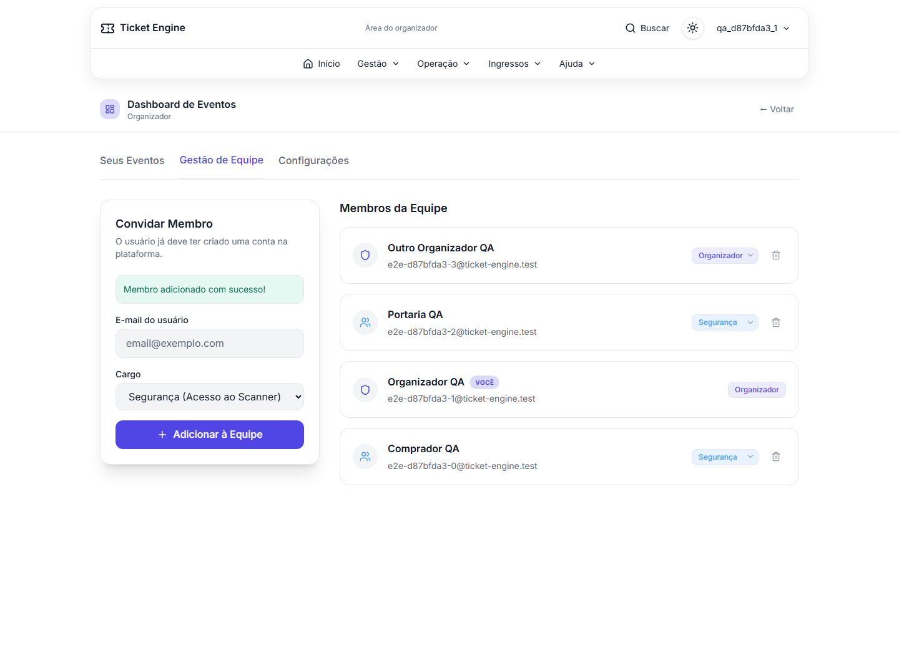
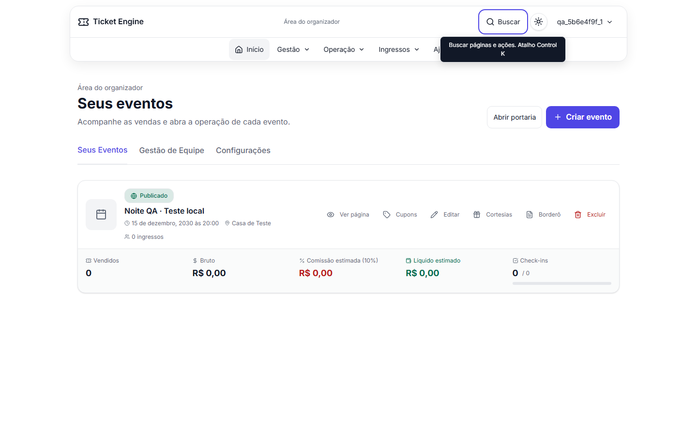
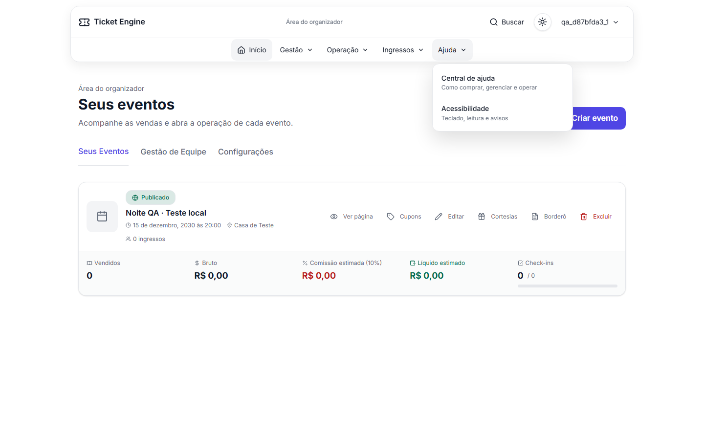

# Revisão técnica da refatoração

Revisão local em 13/11/2026. Escopo: fluxos financeiros, entrada por evento, controle de acesso e mudanças do MR de refatoração. Não constitui auditoria completa de segurança nem homologação do Asaas.

## Resultado

O código pode seguir para revisão humana. A rodada encontrou e corrigiu falhas adicionais na gestão de equipe. As restrições para produção continuam no [relatório da implementação](relatorio-implementacao.md#avaliação-para-revisão).

## Achados corrigidos

| Prioridade | Antes | Correção e impacto | Trade-off |
|---|---|---|---|
| Alta: alteração de permissão por origem indevida | A API de equipe aceitava JSON sem verificar origem ou tipo de conteúdo. Uma origem irmã no mesmo site podia enviar POST simples com `text/plain` e cookies de uma sessão organizadora | POST e DELETE usam `assertSameOrigin`; POST exige JSON e limita o corpo. A origem irmã recebe 403, sem mudança no banco | Depende de `NEXT_PUBLIC_SITE_URL` confiável e da configuração correta do proxy. Essa proteção não substitui autorização nem impede XSS na própria aplicação |
| Média: perda do próprio acesso | POST permitia ao organizador mudar sua própria role para STAFF, apesar de DELETE já impedir a própria remoção | O serviço recusa mudança da própria role. Impede perder acesso à gestão por requisição direta | Outro organizador precisa fazer a mudança intencional de cargo |
| Média: autorização desatualizada e remoção concorrente | A API conferia a role antes da escrita. Dois organizadores podiam validar suas permissões e remover um ao outro | A transação trava ator e alvo por ID em ordem estável e revalida a role sob trava. Duas remoções simultâneas produzem 200 e 403; um organizador permanece | Contenção curta entre alterações envolvendo as mesmas contas. Não cria vínculo de equipe por casa |
| Média: formulário informa sucesso e erro | O backend adicionava o membro, mas o cliente chamava `e.currentTarget.reset()` após `await`. O React já havia limpado essa referência. A lista não atualizava | Captura o formulário antes do `await`, limpa os campos e atualiza a lista após sucesso. Associa labels e anuncia resultado/erro com roles acessíveis | Mantém o fluxo de recarga da lista pelo servidor, com uma consulta adicional |
| Média: tooltip bloqueia navegação | Escape fechava a busca e restaurava o foco; esse foco recriava a legenda sobre o menu seguinte | Escape limpa a legenda após o retorno de foco. Ativar um controle também fecha a legenda para liberar seu menu | Limpeza adicional no próximo frame; preserva hover/foco, texto alcançável pelo ponteiro e portal de diálogos |

Implementação: [API de equipe](../src/app/api/painel/equipe/route.ts), [serviço transacional](../src/services/team.service.ts) e [formulário](<../src/app/(staff)/painel/equipe/_components/add-team-member-form.tsx>).

## Evidências

Os testes de origem indevida e autorrebaixamento falharam antes da correção: esperavam 403/400 e recebiam 200. A integração usa PostgreSQL descartável, aplica migrations reais e confere a role persistida. Os sete cenários novos passaram; a suíte completa passou com 51 testes.

O HTTP real acrescentou seis regressões com Supabase Auth e cookies reais: adição/remoção legítima, duas origens indevidas, autorrebaixamento, acesso insuficiente e remoção simultânea. A suíte completa passou com 22 testes. O banco dos testes e as identidades sintéticas são distintos da massa manual.

O navegador reproduziu o erro do formulário antes do ajuste: a asserção de campo vazio recebia o e-mail ainda preenchido, e a página exibia `Cannot read properties of null (reading 'reset')` junto do sucesso. A regressão também exige que o novo membro apareça na lista. O teste integra a [suíte de jornadas](../test/browser/journeys.spec.ts).

| Antes | Depois |
|---|---|
|  |  |

O teste de teclado reproduziu o tooltip ainda visível depois de Escape; o clique seguinte no menu não concluía. Depois do ajuste, hover mostra a legenda, Escape fecha busca/legenda e devolve o foco, e o menu Ajuda abre e navega. Passou nas duas larguras. Contrato: [Design System](design-system.md#tooltips).

| Antes: legenda permanece sobre a navegação | Depois: menu livre e acionável |
|---|---|
|  |  |

## Limites que permanecem

- A equipe tem roles globais. O modelo não possui casa/tenant nem vínculo entre organizador e membro. Não publicar como SaaS para casas independentes sem definir esse isolamento.
- Os cenários financeiros cobrem regras, concorrência e efeitos persistidos com gateway simulado. Não provam aprovação de cartão, estorno bancário ou conciliação com extrato real.
- Não houve ensaio sustentado de pico, auditoria integral de autorização, avaliação de dispositivos físicos ou certificação de acessibilidade.
- Esta revisão não fez merge nem liberou produção.
