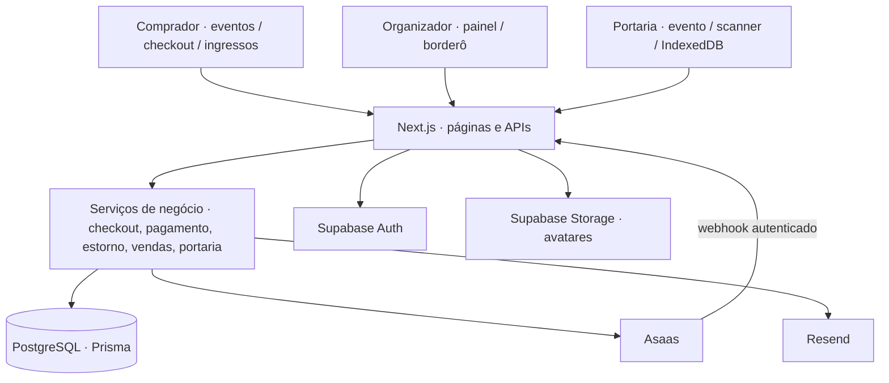
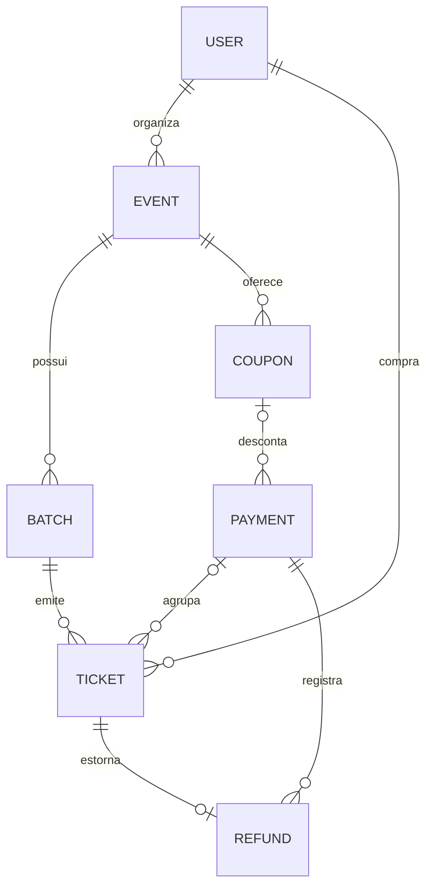
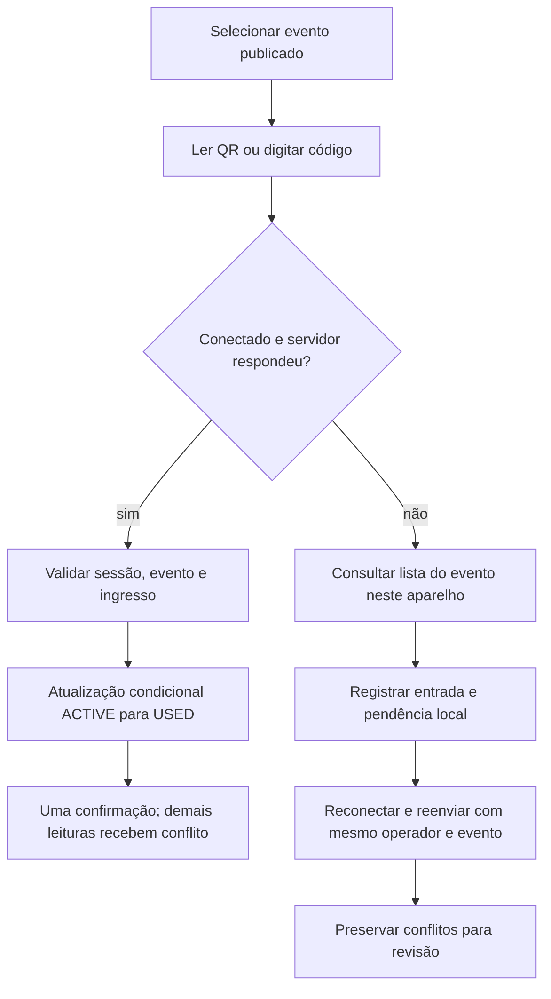

# System Design do Ticket Engine

Mapa do sistema implementado, atualizado em 12/11/2026. Leia para entender responsabilidades, chamadas, persistência e limites. Não é prova de capacidade de produção. Validação e pendências ficam no [relatório](relatorio-implementacao.md).

## Stack e unidades de execução

Monólito modular em Next.js App Router, React e TypeScript. Páginas, Server Actions e APIs compartilham o deploy. A versão alvo de Next e suas dependências estão no [package.json](../package.json); use o lockfile para instalar. Prisma 5.22 acessa PostgreSQL. Supabase autentica e guarda avatares. Asaas cobra e estorna; Resend envia ingressos. Mapbox é opcional para o mapa.



Não há microsserviços, broker ou Redis. O navegador não recebe Prisma, senha do banco ou chave privada do gateway. `src/proxy.ts` renova sessão; APIs e páginas protegidas também verificam identidade e autorização.

## Entrada e responsabilidades

| Responsabilidade | Dono | Chamadores |
|---|---|---|
| Início e menus por perfil | [navigation.ts](../src/lib/navigation.ts), [AppNavigation](../src/components/app-navigation.tsx) | `/`, layout, menus |
| Catálogo em cache | [event.service.ts](../src/services/event.service.ts) | `/eventos`, `/evento/[slug]` |
| Autenticação, JSON limitado, origem, erros | [api.ts](../src/lib/api.ts) | APIs alteradas nesta entrega |
| Reserva e criação de cobrança | [checkout.service.ts](../src/services/checkout.service.ts) | `POST /api/checkout` |
| Confirmação e liberação de reserva | [payment.service.ts](../src/services/payment.service.ts) | Checkout e webhook |
| Pix vencido/cancelado | [pix-expiration.service.ts](../src/services/pix-expiration.service.ts) | Webhook |
| Estorno e reconciliação | [refund.service.ts](../src/services/refund.service.ts) | API de reembolso e webhook |
| Faturamento agregado | [sales.service.ts](../src/services/sales.service.ts) | Painel e borderô; PDF usa a resposta do borderô |
| Autorização e transição de entrada | [gate.service.ts](../src/services/gate.service.ts) | Check-in e sincronização |
| Centavos e rateio | [money.ts](../src/lib/money.ts) | Checkout, estorno e vendas |

Os serviços são extrações dos fluxos críticos, não uma regra universal de camadas para todo arquivo antigo. A API resolve contexto HTTP e identidade; o serviço protege invariantes; Prisma executa transações. Chamadas ao Asaas ficam fora das transações para não segurar a conexão enquanto a rede responde.

## Entidades



`Payment` com seus ingressos representa o pedido; não há `Order`. `Ticket.userId` é o comprador, enquanto nome e CPF do participante ficam no ingresso. Transferir o participante não troca a conta proprietária. O evento do pagamento é alcançado pelos ingressos e lotes; pedidos novos são limitados a um único evento.

`Ticket.unitPrice` e `paidAmount` guardam preço e parcela paga no instante da compra. Não dependem do preço atual do lote. `Refund` preserva o histórico do estorno; o total original de `Payment.amount` continua disponível. Reservas de estoque e cupom têm flags no pagamento para liberar uma vez. Schema e migrations: [prisma](../prisma/).

## Compra e confirmação

```mermaid
sequenceDiagram
  actor C as Comprador
  participant API as API Checkout
  participant DB as PostgreSQL
  participant A as Asaas
  C->>API: Participantes, cupom, método, aceite e chave do pedido
  API->>DB: Trava comprador, lotes e cupom; reserva estoque
  DB-->>API: Pedido PENDING / CREATING com valores por ingresso
  API->>A: Criar cobrança com externalReference do pedido
  alt Resposta conhecida
    A-->>API: ID e estado da cobrança
    API->>DB: Salvar ID; READY ou confirmar PAID
  else Resultado incerto
    API->>DB: UNKNOWN; preservar reserva
  end
  A->>API: Webhook de confirmação
  API->>DB: Trava pagamento; PAID e ingressos ACTIVE uma vez
  API-->>C: QR disponível na conta; envio de e-mail após commit
```

Chave igual com o mesmo pedido reutiliza o registro; chave igual com conteúdo diferente retorna conflito. Número/CVV não entram no banco, logs da API nem no identificador do pedido. A chamada externa não é repetida automaticamente após timeout, pois ela pode ter criado uma cobrança. O webhook consegue localizar o pedido pelo `externalReference` mesmo antes de o ID do gateway ser salvo.

Limites atuais: dez ingressos por pedido e três pedidos pendentes por comprador. Cupom considera usos concluídos e reservas. Valor zero conclui como `FREE`, sem criar cobrança de zero no gateway.

Pix e cartão à vista podem ser oferecidos pela casa. Cartão depende de `ENABLE_CREDIT_CARD=true` no servidor e recebe endereço real do titular. Parcelamento está recusado: o schema atual não modela parcelas e seus estornos. Não habilitar apenas trocando um limite na tela.

## Estoque, Pix e reembolso

- Compra reserva `soldQty` antes da cobrança. A recusa definitiva devolve reserva; timeout mantém a reserva para evitar duplicidade.
- `PAYMENT_OVERDUE` consulta a cobrança e confirma sua exclusão no Asaas antes de liberar. Se já estiver paga, confirma a compra. `PAYMENT_DELETED` também confere o estado remoto.
- Liberação trava o pagamento, cancela ingressos pendentes, devolve estoque e reserva do cupom e marca `FAILED`. Repetições não decrementam novamente. Registros antigos sem flag de reserva exigem revisão.
- Reembolso usa centavos rateados por preço original, com distribuição determinística do centavo restante. Dois ingressos de R$ 50 com desconto total de R$ 20 têm R$ 40 pagos por ingresso.
- Antes de estornar, reserva o valor no histórico do pagamento e torna o ingresso indisponível. Limite considera outros estornos locais e externos conhecidos.
- `DONE` conclui estorno e devolve a vaga uma vez. Recusa ou cancelamento definitivo restaura o ingresso; resultado incerto fica para reconciliação. Não interpretar HTTP 200 ou existência de um item em `refunds` como dinheiro devolvido.

Asaas: [Pix](https://docs.asaas.com/docs/cobrancas-via-pix), [exclusão de cobrança](https://docs.asaas.com/reference/excluir-cobranca), [estornos](https://docs.asaas.com/docs/estornos). Não foi configurado cron nesta entrega. Webhooks perdidos e operações `UNKNOWN` precisam de acompanhamento operacional; não há fila durável nem tela de conciliação completa.

## Portaria e contingência



`eventId` é obrigatório. Ingresso de outro evento é recusado sem consumi-lo. O banco decide quem vence leituras simultâneas; uma variável no navegador não resolveria vários operadores.

A sincronização pagina mil ingressos por requisição e restringe o evento. IndexedDB separa operador e evento, preserva a fila e sinaliza dados de versões antigas que precisam de revisão. Cache offline não recebe cancelamentos ou transferências feitos depois do download. Dois aparelhos desconectados não conseguem garantir exclusão entre si. Contingência exige uma única fila offline, página previamente aberta e revisão ao reconectar; não há PWA que garanta abertura fria sem rede.

## Finanças e consultas sob pico

O banco agrega valores sem hidratar todos os ingressos no Node. Um pagamento é distribuído entre seus ingressos e somado uma vez. Snapshots comprovados têm prioridade; dados antigos usam rateio identificado como estimativa, mantendo o total do pagamento. A consulta considera todos os ingressos do pedido antes de separar eventos antigos que cruzavam eventos.

O painel pagina cinquenta eventos. O catálogo guarda um DTO com datas ISO e preços numéricos, evitando depender de classes Date/Decimal após a serialização do cache. Catálogo e detalhes usam cache público; a raiz que escolhe o perfil é dinâmica. APIs privadas usam `private, no-store`. Publicação/edição invalida o catálogo. Comissão e líquido são estimativas comerciais; ainda não há conciliação contábil completa de taxas, splits e extratos do Asaas.

O catálogo só retorna lista vazia após uma consulta bem-sucedida sem publicações futuras. Falhas da consulta saem do callback do cache e chegam a `src/app/eventos/error.tsx`, com mensagem de indisponibilidade e `retry()` do Next para refazer a requisição. Uma falha não é convertida em sucesso vazio; o cache de resultados válidos e seu prazo de 30 segundos são mantidos. O layout da rota preserva navegação e rodapé durante o erro.

Criação e edição convertem a entrada de Brasília para ISO explícito. O editor reconstrói a hora da casa em vez de tratar UTC como hora local. A conversão compartilhada está em [event-date-time.ts](../src/lib/event-date-time.ts); o contrato atual usa um fuso e precisão de minutos nos campos.

Travas por recurso preservam estoque, cupom, estorno e entrada entre instâncias. Elas também criam espera quando todos disputam o mesmo lote. Escalar processos sem dimensionar conexões pode piorar o pico. Não foi medido limite de requisições por segundo nem p95/p99 em infraestrutura de produção.

## Infraestrutura e implantação

Desenvolvimento: Supabase CLI 3.1.0 no Docker, PostgreSQL local `54322`, Auth/API `54321`, Studio `54323`; Next no Node do host, porta `3000`. Testes criam outro PostgreSQL descartável. Nunca usar seed destrutivo para testar concorrência.

O [gerenciador local](desenvolvimento-local.md) mantém o front independente do terminal. A suíte de navegador reutiliza o ambiente E2E, com Auth real, PostgreSQL descartável e Asaas simulado; o job `browser` prepara a mesma infraestrutura no CI.

Produção: build instala também ferramentas de compilação, gera Prisma e executa Next com `NODE_ENV=production`. Runtime precisa de `@prisma/client` em `dependencies`; a CLI pode ser removida depois do build. Conexão de runtime pode usar pool; migrations precisam da conexão direta. Hospedagem efetiva, limites do plano, região, backups, recuperação e configuração de segredos não foram inspecionados.

Migrations são aditivas. Banco vazio recebe baseline e expansão por `migrate deploy`. Banco existente precisa ser comparado ao baseline antes de marcar a baseline como aplicada. Não executar `migrate reset` em banco com dados. Não apagar colunas ou histórico de estornos para voltar uma versão.

## Fronteiras e limites

- Role e propriedade são conferidas nas APIs alteradas. Organizador atua nos próprios eventos. `STAFF` opera eventos da casa inteira no modelo atual.
- Não há entidade de casa/tenant nem associação de equipe por evento. Não vender este isolamento como SaaS multicasas.
- O QR do e-mail é gerado como PNG no servidor e enviado como anexo inline por CID; não usa um gerador público externo. E-mails são enviados depois do commit, sem outbox ou retentativa durável. A conta do comprador continua sendo a fonte do ingresso.
- Falhas internas retornam mensagem genérica e não serializam erros Axios com headers e cartão. Isso não substitui política de retenção, monitoramento e revisão dos demais endpoints.
- Testes com gateway simulado comprovam regras locais. Sandbox, câmera, áudio, leitor de tela e carga em infraestrutura equivalente são validações separadas.

Interface: [Design System](design-system.md). Jornadas e comandos: [validação local](testes-locais.md). Evidências, decisões e pendências: [relatório](relatorio-implementacao.md).
