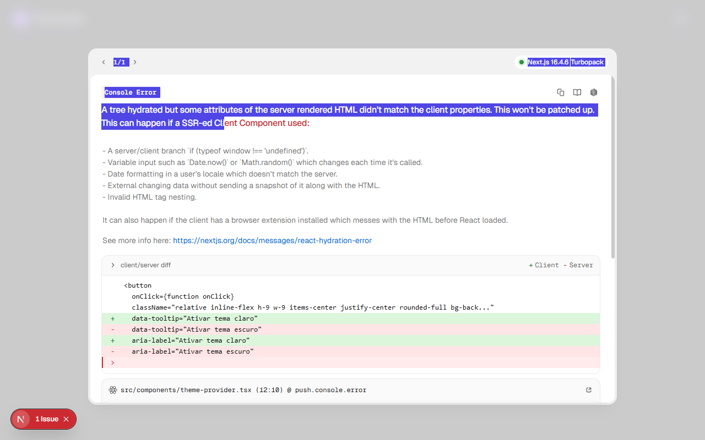
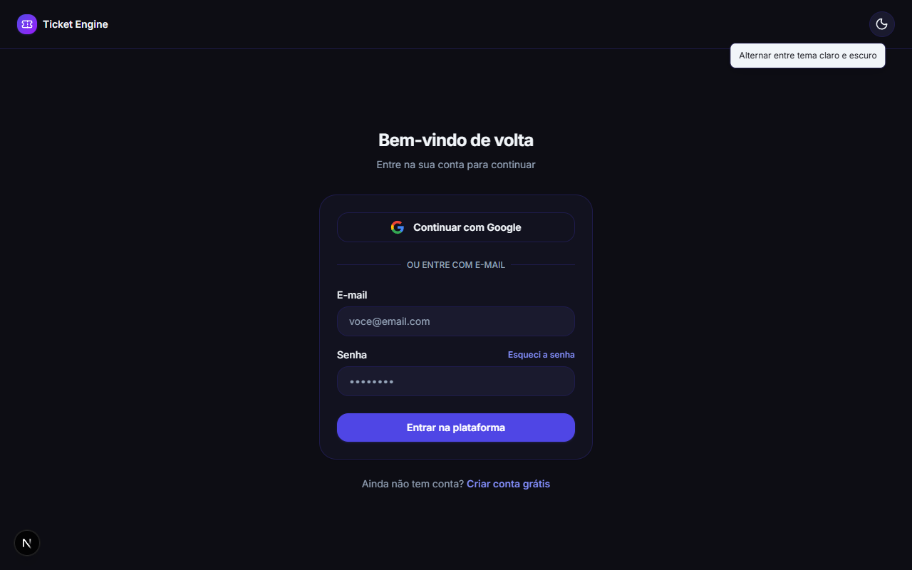
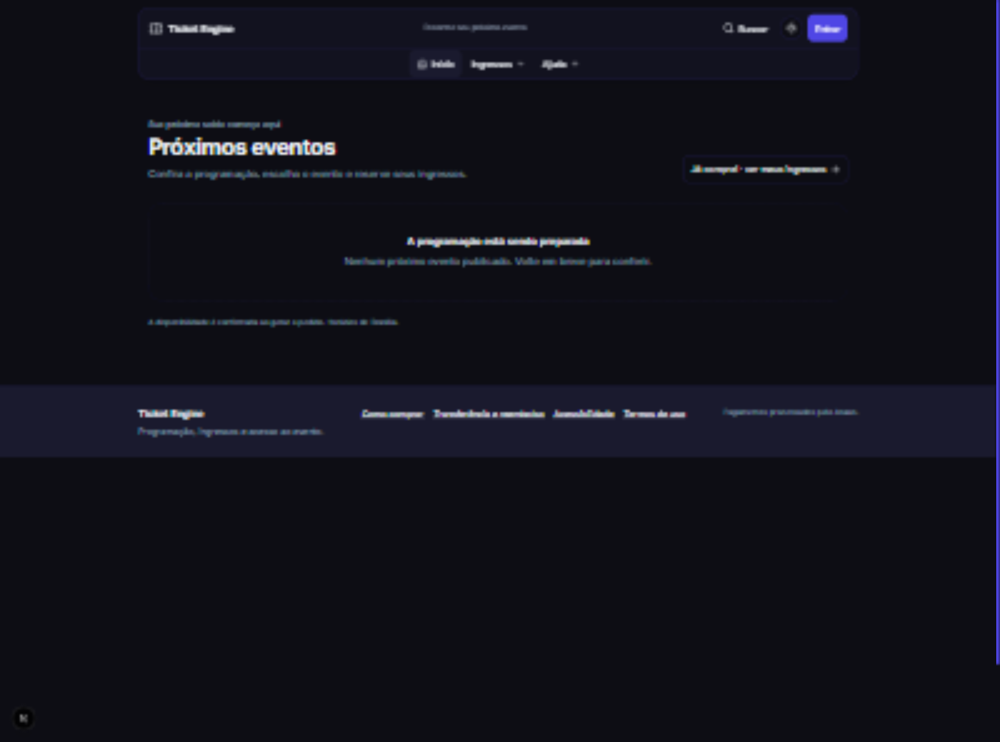
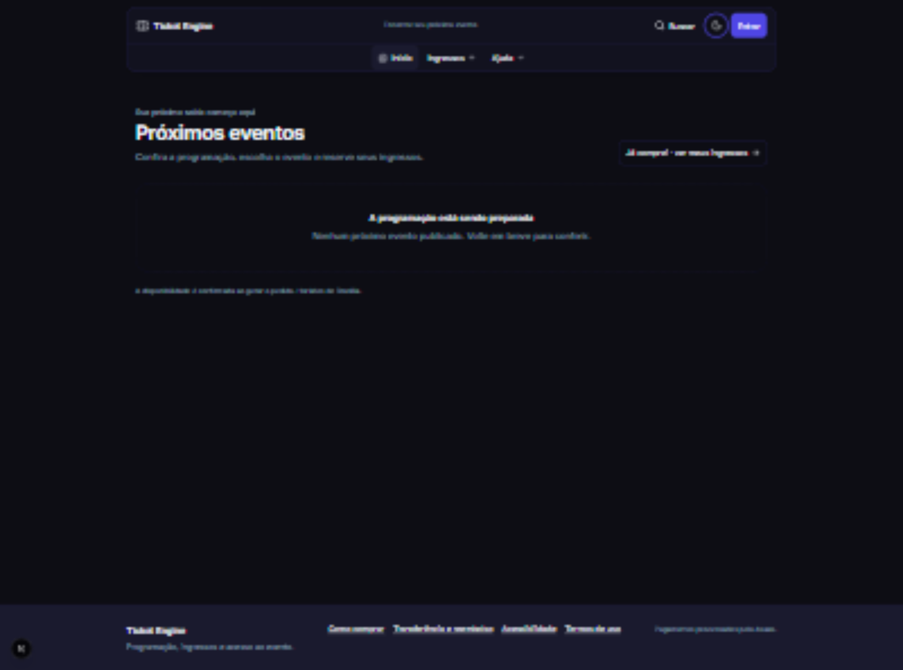

# Validação local das jornadas — 12 e 13/11/2026

Plano da etapa solicitada após adiar os MRs. O servidor normal permanece na porta 3000. Os testes de escrita usam PostgreSQL descartável, contas exclusivas no Auth local e aplicação separada na porta 3101. Asaas é interceptado no processo de teste; envio Resend fica desabilitado. Não usar credenciais ou serviços de produção.

## Matriz

| Área | Cenários |
|---|---|
| Visitante | Catálogo, detalhes, seleção de lote, ajuda, tema, busca e teclado |
| Comprador | Login, Pix, confirmação por webhook simulado, cartão aprovado/recusado/em análise, cupom, QR e transferência/reembolso |
| Organizador | Início, criação/edição/publicação, cupons, cortesias, borderô e acesso a evento alheio |
| Portaria | Evento obrigatório, evento errado, entrada única, repetição, lista por evento e fila offline |
| API real | Sessão/cookies, origem, conteúdo inválido, reenvio de pedido, concorrência e ausência de alterações indevidas |
| Acessibilidade | Axe no navegador, menus por teclado, Escape/foco, tooltips e largura de celular |
| Empacotamento | Lint, testes existentes, instalação/build e runtime pertinentes ao diff final |

A inspeção visual e os testes HTTP não substituem câmera física, som audível em aparelho, antifraude real, entrega externa de e-mail ou carga em produção. As regras de prazo e valor continuam cobertas por testes com relógio controlado; a jornada HTTP usa serviços locais reais e fixtures com janelas amplas.

**Resultado da rodada inicial: 86 testes automatizados passaram, além das jornadas de navegador descritas abaixo.** O usuário autorizou commit e push e, depois da correção de tema registrada abaixo, também a abertura do MR.

## Evidência automatizada

| Verificação | Resultado |
|---|---|
| `npm run lint` | Passou |
| `npm run check:ui` | 81 controles com ícones possuem tooltip no código |
| `npm test` | 32 testes, oito arquivos; inclui hidratação e falha de consulta do catálogo |
| `npm run test:integration` | 44 testes com PostgreSQL descartável e migrations reais; inclui filtro de publicações futuras |
| `npm run test:e2e:http` | 16 testes no servidor Next de produção, com Auth/cookies Supabase reais e Asaas simulado |
| `NODE_ENV=production npm ci --include=dev` + `npm run build` | Passou em cópia isolada, incluindo `prisma generate` |
| Runtime após `npm prune --omit=dev --ignore-scripts` | Iniciou e serviu o catálogo; TypeScript, Vitest e ESLint ausentes |
| `npm audit --omit=dev` | Quatro avisos baixos; zero moderado, alto ou crítico |

A suíte HTTP verifica início por perfil, sessão/permissão, JSON/CPF/termos inválidos, limite de ingressos, recusa de parcelas e mistura de eventos. Também cobre preço calculado no servidor, receita de três ingressos, cobrança repetida, resposta perdida após criar cobrança, cartão em análise/recusado, endereço do titular, estorno proporcional, expiração/cancelamento repetido de Pix, evento errado, manifesto por evento, check-in simultâneo, propriedade de evento/cupom, capacidade de cortesia, ingresso usado e origem/token inválidos.

Vinte reenvios HTTP do mesmo pedido criaram uma cobrança; vinte solicitações do mesmo estorno enviaram um estorno; vinte leituras simultâneas aceitaram uma entrada. São provas dessas invariantes em uma instância local. Não medem a capacidade de pico de produção.

## Jornadas exercitadas no navegador

| Jornada | Evidência observada |
|---|---|
| Compra Pix | Seleção de três ingressos, preenchimento de participantes, QR/código Pix, webhook simulado e três ingressos ativos na carteira |
| Cartão e cupom | `QA20` reduziu R$ 50 para R$ 40; envio de endereço/telefone e liberação do ingresso |
| Cancelamento | Janela informou R$ 40; gateway simulado recebeu R$ 40; ledger ficou `DONE` e carteira mostrou cancelado |
| Transferência | Formulário concluiu; carteira mostrou o convidado e registrou o limite de uma transferência |
| Retomada de compra | Depois de consultar o Pix pago, a tentativa atual saiu do sessionStorage e uma nova compra do mesmo lote abriu o checkout |
| Organização | Criou rascunho com lote, publicou, criou/desativou/excluiu cupom e salvou edição |
| Horário | Edição mostrou 20h para `23:00Z`; salvar preservou `2030-12-15T23:00:00.000Z` |
| Cortesias | Emissão de três pela tela; respeito à capacidade também coberto na API |
| Portaria | Leitor bloqueado sem evento; evento errado mostrou o nome correto; erro criou oscilador de 220 Hz |
| Leitura QR | Upload de PNG decodificado pelo html5-qrcode confirmou a entrada; repetição foi recusada |
| Offline simulado | Duas entradas foram gravadas no IndexedDB; ao reconectar, uma confirmou e outra virou conflito após cancelamento concorrente |
| Separação por evento | Evento B mostrou zero pendências; voltar ao A recuperou o conflito; remoção exigiu confirmar revisão |
| Navegação | Busca por Control+K, Escape com retorno de foco, tooltip por hover, menu de conta/logout e larguras de 320/375/1280 px |

O offline foi simulado alterando `navigator.onLine` e emitindo eventos online/offline, com a tela previamente aberta. Isso exercita a fila do cliente e sua reconciliação HTTP; não é ensaio de queda física de rede nem abertura fria offline.

## Borderô e acessibilidade

O PDF baixado foi extraído, renderizado e inspecionado. Uma página apresentou R$ 90 brutos, R$ 40 de estorno, R$ 50 após estornos, R$ 5 de comissão estimada e R$ 45 líquidos estimados. API, painel e PDF concordaram. O relatório identificou três cortesias e quatro ingressos válidos. Extrato real do Asaas continua fora desta validação.

Axe usou as regras `wcag2a`, `wcag2aa` e `wcag21aa`. As verificações dos estados corrigidos passaram em catálogo, Pix/QR, carteira, transferência, reembolso, cortesia, painel claro/escuro, edição de dados/lotes, cupons e portaria. O cartão claro passou; no escuro, a legenda ainda usava cinza fixo. A aplicação do token semântico no DOM eliminou o erro, e a mesma classe foi corrigida no código e incluída no build final.

As janelas de ingresso e cortesia foram verificadas como diálogos nativos: abertura acima da barra, fundo inerte, Escape e retorno de foco. Isso não certifica todos os modais, estados de erro, componentes do leitor de terceiros ou conformidade WCAG do produto inteiro.

O tooltip atrás do diálogo foi reproduzido em janela real na porta 3101. A correção do host foi conferida no build de produção sem ferramentas de desenvolvimento: um diálogo temporário na página pública exibiu o tooltip dentro da janela, e o hit-test retornou o próprio tooltip. A tentativa de iniciar esse runtime com sessão/banco descartável foi recusada pela revisão automática (`blocked by policy`, sem motivo detalhado); a verificação pública foi a alternativa usada.

## Correções encontradas nesta rodada e trade-offs

| Correção | Motivo e solução | Trade-off |
|---|---|---|
| Contraste | Tokens legíveis para Pix, texto de apoio, verde do painel e links no escuro | As cores de texto se afastam das cores fixas antigas; marca dos botões permanece separada |
| Barra em 320 px | Conta compacta com ícone e nome acessível; marca não quebra | Nome da conta fica no menu/tooltip em tela pequena |
| Pix estreito | QR quadrado, campo flexível com `min-width: 0` e label associado | A imagem reduz com a largura disponível; câmera física ainda precisa de ensaio |
| Diálogos | Transferência, reembolso e cortesia usam `dialog.showModal()` | Depende de navegador com suporte a diálogo nativo; outros modais legados não foram convertidos |
| Tooltip em diálogo | Portal usa o diálogo como host quando o controle pertence a ele | A camada acompanha a janela nativa; `z-index` no body sozinho ficava atrás do modal |
| Rótulos | Campos de checkout, cortesia, edição/criação e cupons receberam associação explícita | Formulários antigos restantes exigem a mesma revisão; não houve troca de biblioteca |
| Pix já pago | Botão consulta o pedido antes da carteira; confirmação limpa a tentativa concluída | Uma consulta adicional; falha conserva o pedido para retomada segura |
| Horário do evento | Formulários convertem Brasília para ISO explícito e voltam a Brasília ao editar | Fuso único da casa e precisão de minutos na entrada; múltiplos fusos exigem outro contrato |
| Isolamento E2E | Banco e contas próprios; servidor compilado separado; interceptação apenas do gateway | Inicialização custa um build e exige Supabase/Docker local; não homologa o provedor real |

O erro de horário foi reproduzido: editar 20h mostrava 23h, e salvar mudava `23:00Z` para `02:00Z` do dia seguinte. Quatro regressões falharam com a conversão anterior; seis cenários de data passaram após a correção, incluindo virada de ano e datas inválidas. Código: [src/lib/event-date-time.ts:1](../src/lib/event-date-time.ts).

## Correção posterior: hidratação do tema

Um tema escuro salvo produzia atributos diferentes no servidor e no primeiro render do navegador. O aviso foi reproduzido em `/login`, que compartilha o controle com `/painel`. O teste de HTML inicial falhou antes da correção; os 30 testes unitários passaram depois. O contrato do componente está no [Design System](design-system.md#tema).

Foram verificadas recargas com tema escuro salvo, tema claro salvo e preferência escura do sistema sem valor salvo. Nenhuma produziu novo erro de hidratação. O clique alternou para claro e persistiu a escolha; o tooltip manteve o nome acessível.

`npm run lint` e `npm run check:ui` passaram. O build no diretório de desenvolvimento encontrou `EPERM` ao substituir a DLL do Prisma em uso. Uma cópia isolada recebeu `npm ci --include=dev` e executou `NODE_ENV=production npm run build` com sucesso, sem parar a porta 3000 nem gravar `.env` na cópia. Naquela etapa de atributos do botão, a suíte somava 89 casos; integração e HTTP foram repetidos na atualização do catálogo descrita abaixo.

O audit atual mantém quatro avisos baixos em produção. Incluindo ferramentas de desenvolvimento, são 13 moderados e três altos adicionais (`brace-expansion`, `js-yaml`, `zod`), com correção indicada. Esta correção de interface não atualizou dependências.

| Antes: erro reproduzido | Depois: tooltip e tela sem o erro |
|---|---|
|  |  |

## Atualização: catálogo, rodapé e tema escolhido

**Resultado da retomada de 13/11: 92 testes passaram — 32 unitários, 44 de integração e 16 HTTP.** O servidor E2E recompilou o código final com `NODE_ENV=production`. O build completo isolado, lint e checagem de UI também passaram; schema e dependências não mudaram nesta correção.

O banco local continha sete eventos publicados futuros. A página voltou a listá-los ao retomar o front. Não há log preservado para atribuir a imagem original a uma falha específica, mas o teste reproduziu o defeito do serviço: erro de consulta retornava `[]`. Essa falha agora alcança o boundary da rota e não é armazenada como sucesso vazio. [Fluxo e cache](system-design.md#finanças-e-consultas-sob-pico).

O cenário visual usou PostgreSQL vazio descartável em `ticket_engine_catalog_ui`, com outro Next em 3101. Em uma janela de 1600 × 1188, o rodapé terminava em 732,375 px antes da correção; depois, terminou em 1188 px, sem rolagem artificial. As larguras CSS de 320 e 375 px não apresentaram transbordamento horizontal ou sobreposição entre conteúdo e rodapé. Isso verifica responsividade, não um aparelho móvel físico.

A falha de consulta foi provocada somente nesse banco descartável. A página exibiu “Eventos indisponíveis no momento”, sem a mensagem de agenda vazia, preservando navegação e rodapé. Restaurar a tabela e clicar em “Tentar novamente” recuperou o catálogo pelo `retry()` do Next 16.4. A integração também prova que eventos passados, rascunhos e cancelados não aparecem como publicações futuras.

As variantes `dark:` seguiam o sistema operacional, apesar da escolha manual do app. A regra agora segue `.dark`. O navegador confirmou ambos os casos: escolha escura com sistema claro e escolha clara com sistema escuro; os ícones acompanharam a escolha sem alterar os atributos estáveis da hidratação. [Contrato visual](design-system.md#tema).

Durante a limpeza, o Docker Desktop encerrou e o pipe do engine desapareceu. A primeira tentativa da suíte HTTP não iniciou; o front mostrou indisponibilidade real do banco. O Desktop foi aberto novamente, sem reset de volumes. A suíte HTTP passou na retomada, e a limpeza do ambiente visual foi conferida separadamente. O script temporário não integra o código de produção.

| Antes: rodapé no meio da janela | Depois: rodapé na base, no fluxo |
|---|---|
|  |  |

[Captura em largura de celular](evidencias/catalogo-vazio-celular.png). O cenário vazio é uma fixture; os eventos e as contas do usuário não foram removidos ou republicados.

## Reproduzir sem alterar a massa do usuário

1. Inicie Supabase local e Docker. Use o `.env` local, com service role local disponível, sem imprimir suas chaves.
2. No Windows, se necessário: `$env:DOCKER_HOST='npipe:////./pipe/dockerDesktopLinuxEngine'`.
3. Execute `npm run test:e2e:server`. Aguarde a mensagem de pronto na porta 3101.
4. Em outro terminal, execute `npm run test:e2e:http`. A aplicação está em `http://localhost:3101`.
5. As identidades exclusivas e dados efêmeros ficam em `supabase/.temp/e2e-state.json`, ignorado pelo Git. A senha sintética está no launcher; não é senha de conta real.
6. Ao terminar, execute `npm run test:e2e:stop`. Aguarde o launcher encerrar; só as identidades com a marca deste run e o banco descartável são removidos.

Fontes: [launcher](../test/e2e/local-server.mjs), [cenários HTTP](../test/e2e/http.test.mjs), [simulador](../test/e2e/gateway-preload.mjs). `.next-e2e` separa o build dos testes do front normal e é ignorado por Git/ESLint.

**Armadilha:** Nock 15 recebe `Request` no callback. O corpo vem de `await request.json()`. Usar o contrato antigo com dois argumentos fez o simulador aguardar callback e causar timeout; isso foi corrigido na infraestrutura de teste, sem mudar o cliente Asaas da aplicação.

## Limites e próxima revisão

Continuam pendentes Asaas sandbox/extrato/splits, e-mail externo, câmera física, áudio audível, navegador móvel real, leitor de tela, zoom, perda física de rede e carga equivalente ao pico esperado. O CI do commit anterior `4dfea4e` passou; cada novo push exige conferir seus próprios checks. O leitor de terceiros ainda expõe controles em inglês; o editor mantém um campo de planta anunciado como futuro, sem persistência. Esses pontos não receberam funcionalidade nova nesta rodada.

Os ensaios foram locais e preservaram a massa existente. As portas 3100–3103 foram encerradas e a conferência do Auth encontrou zero identidades exclusivas restantes. O front normal respondeu 200 na porta 3000. A cópia de build temporária permanece fora do Git; a limpeza havia sido bloqueada pela revisão automática, como registrado no relatório.

**Revisão técnica: pode seguir quando solicitado. Produção: ainda não homologada.** Os trade-offs financeiros e operacionais completos permanecem no [relatório da implementação](relatorio-implementacao.md).
